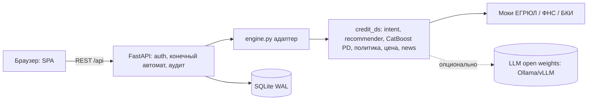

# Диаграмма состояний заявки
```mermaid
stateDiagram-v2
  [*] --> SUBMITTED
  SUBMITTED --> VALIDATION --> ENRICHMENT --> SCORING
  SCORING --> OFFER_READY: APPROVED / COUNTER_OFFER
  SCORING --> NEED_INFO
  SCORING --> UNDERWRITER_REVIEW: MANUAL_REVIEW
  SCORING --> DECLINED
  UNDERWRITER_REVIEW --> OFFER_READY
  UNDERWRITER_REVIEW --> NEED_INFO
  UNDERWRITER_REVIEW --> DECLINED
  NEED_INFO --> SCORING: клиент дополнил данные
  NEED_INFO --> CANCELLED
  OFFER_READY --> OFFER_ACCEPTED
  OFFER_READY --> CANCELLED
  OFFER_READY --> EXPIRED: срок оферты истёк
  OFFER_ACCEPTED --> SIGNED --> DISBURSED
```
# Модель данных
```mermaid
erDiagram
  users ||--o{ applications : подаёт
  users ||--o{ sessions : токены
  applications ||--o{ events : "аудит-лог переходов"
  users { int id; text login; text role; json company }
  applications { int id; text status; json form; json decision "исход, оферта, PD, SHAP, trace, обогащение" }
  events { int id; text ts; text status; text note; text actor }
```
# Архитектура

